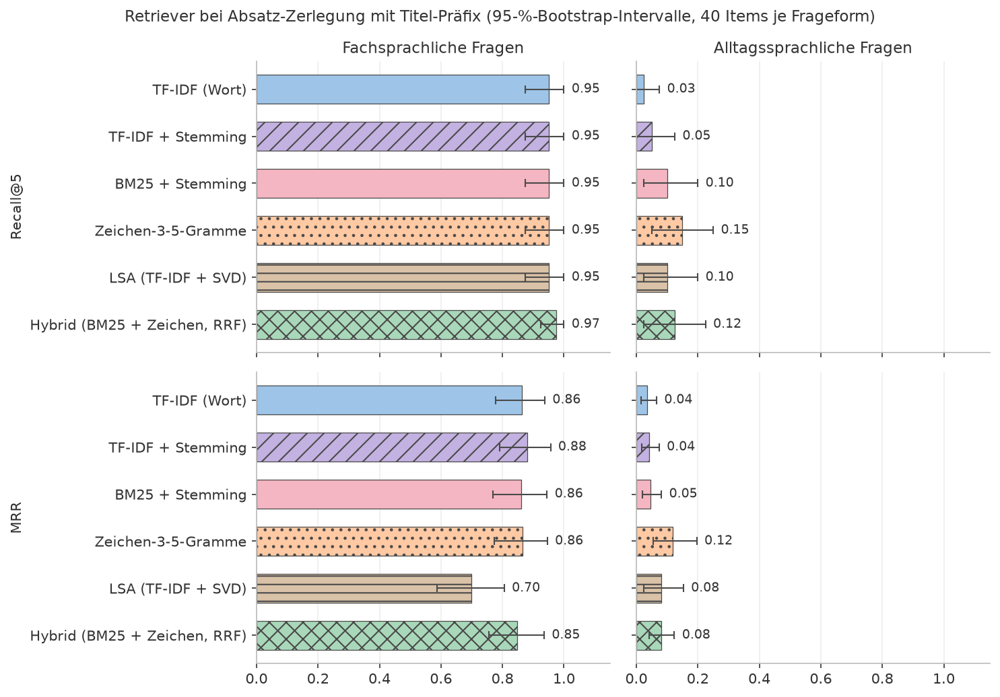
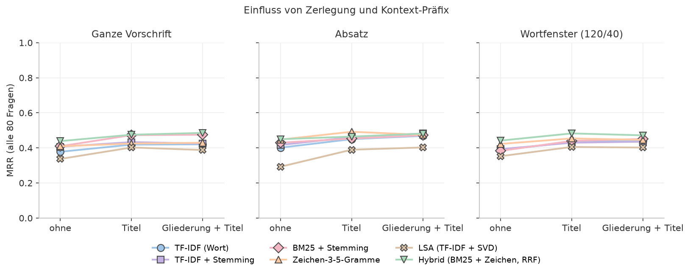
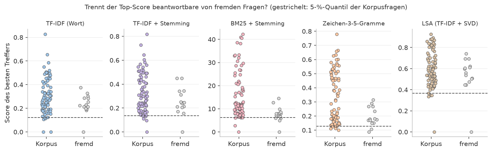

# RAG für das Strahlenschutzrecht

Ein kleiner, nachvollziehbarer Prototyp für Retrieval-Augmented Generation (RAG) auf dem
Strahlenschutzgesetz (StrlSchG) und der Strahlenschutzverordnung (StrlSchV), mit einer
Auswertung, die die Schwächen des Systems sichtbar macht statt sie zu verdecken.

Das Projekt hat drei Teile: Abschnitte des Korpus abrufen, daraus eine Antwort mit Quellenangaben bauen und
messen, wie gut beides funktioniert. Der Schwerpunkt liegt auf dem dritten Teil.

> Keine Rechtsberatung. Antworten des Systems können falsch oder unvollständig sein.

## Kernergebnisse

Gemessen auf 40 selbst erstellten Fragen-Items. Jedes Item gibt es in zwei Formen: einmal
**fachsprachlich**, nah am Gesetzeswortlaut, und einmal **alltagssprachlich**, ohne die Begriffe der Vorschrift.
In Klammern stehen 95-%-Bootstrap-Intervalle über Items.

| Frageform | Recall@1 | Recall@5 | MRR |
|---|---|---|---|
| fachsprachlich | 0,80 [0,68; 0,93] | 0,95 [0,88; 1,00] | 0,86 [0,77; 0,94] |
| alltagssprachlich | 0,00 [0,00; 0,00] | 0,10 [0,03; 0,20] | 0,05 [0,02; 0,08] |

*Referenzvariante: Zerlegung in Absätze, Titel der Vorschrift als Präfix, BM25 mit Stemming.*

1. **Wortbasiertes Retrieval funktioniert, solange die Frage die Sprache des Gesetzes
   spricht.** Für alltagssprachliche Fragen bricht es fast vollständig ein.
   „Wie viel Strahlung darf ich als Beschäftigter pro Jahr höchstens abbekommen?“ findet
   § 78 StrlSchG („Grenzwert der effektiven Dosis … beruflich exponierte Personen“) nicht.
   Auch bei 20 abgerufenen Vorschriften erreicht keine der 54 Varianten mehr als 0,43 Recall.
2. **Keine der getesteten Varianten schließt diese Lücke.** Getestet wurden Stemming, BM25, Zeichen-n-Gramme,
   LSA und ein Hybrid über Reciprocal Rank Fusion. Die beste Variante, Zeichen-n-Gramme, erreicht bei
   Alltagsfragen Recall@5 = 0,15 [0,05; 0,25]. Gegenüber der Referenz ist keine Variante
   messbar besser: Die gepaarte MRR-Differenz von Zeichen-n-Grammen beträgt +0,04 [−0,04; +0,12].
   LSA ist schlechter (−0,06 [−0,13; −0,01]).
3. **Der Titel als Präfix hilft ein wenig, kleinere Abschnitte nicht.** Ohne Titel-Präfix
   sinkt die MRR um 0,02 [0,004; 0,05]. Wortfenster ohne Präfix liegen 0,07 [0,03; 0,12] unter der Referenz.
   Ganze Vorschriften und Absätze liegen gleichauf.
4. **Enthaltung über eine Score-Schwelle trägt nicht.** BM25 trennt Korpusfragen von
   15 fachfremden Fragen nur mit AUC = 0,80 [0,68; 0,90]. Bei einer Schwelle, die 95 % der
   Korpusfragen durchlässt, kommen 11 von 15 Fremdfragen ebenfalls durch. Darunter sind
   Fragen nach dem Mindestlohn und nach Urlaubstagen.
5. **Die extraktive Antwort ohne Sprachmodell zitiert korrekt, wenn das Retrieval stimmt.**
   Bei Fachfragen steht der gesuchte Wert, z. B. „20 Millisievert“, in 93 % der Fälle im
   Kontext und in 68 % der Fälle in der Antwort. Bei Alltagsfragen liegen die Werte bei 17 % und 12 %.

Für ein Wissenssystem heißt das: Das **Retrieval ist der Engpass**, nicht die Formulierung
der Antwort. Die nächsten Schritte sind dichte Embeddings und eine Umformulierung der
Anfrage durch ein Sprachmodell. Beides ist im Code angelegt, aber hier noch nicht gemessen
(siehe [Grenzen](#grenzen-und-nicht-getestetes)).




## Aufbau

```
src/strlrag/
  korpus.py      XML von gesetze-im-internet.de -> Vorschriften (Titel, Gliederung, Absätze)
  text.py        Normalisierung, Stoppwörter, CISTEM-Stemmer, Satzzerlegung
  chunking.py    Zerlegung: ganze Vorschrift | Absatz | Wortfenster; Kontext-Präfix
  retrieval.py   TF-IDF, BM25, Zeichen-n-Gramme, LSA, Hybrid (RRF), Embeddings (optional)
  anfrage.py     Umformulierung der Anfrage durch ein Sprachmodell (optional)
  antwort.py     Prompt mit nummerierten Quellen, Backends (extraktiv, OpenAI-kompatibel, Mock),
                 Enthaltung, Prüfung der Zitate
  evaluation.py  Rang auf Paragraphenebene, Recall@k, MRR, Cluster-Bootstrap, AUC
  daten.py       Pfade und Laden des Standardkorpus
scripts/
  lade_korpus.py     lädt die XML-Dateien nach data/roh/
  pruefe_fragen.py   prüft Soll-Vorschriften und Stichworte gegen den Wortlaut
  experimente.py     rechnet das Variantenraster, schreibt ergebnisse/ und docs/abbildungen/
  frage.py           Kommandozeile: Frage stellen, Antwort mit Quellen
configs/             experimente.yaml (hier gerechnet), experimente_lokal.yaml (Embeddings/LLM)
data/eval/fragen.yaml  40 Items (fach + alltag), 15 Fremdfragen
tests/               47 Tests auf einem synthetischen Testgesetz
```

## Schnellstart

```bash
python -m venv .venv && source .venv/bin/activate
pip install -e ".[dev]"
pytest -q                                   # läuft ohne Rohdaten
python scripts/lade_korpus.py               # StrlSchG + StrlSchV nach data/roh/
python scripts/pruefe_fragen.py             # Fragenset gegen den aktuellen Wortlaut prüfen
python scripts/experimente.py               # ca. 30 s auf einem Laptop-Kern
python scripts/frage.py "Wie oft ist die Unterweisung zu wiederholen?"
```

Ausgabe des letzten Befehls:

```
Danach ist die Unterweisung mindestens einmal im Jahr zu wiederholen. [1] Die Unterweisung hat mündlich zu erfolgen. [2]

[1] StrlSchV § 63 Abs. 1 (Unterweisung)
[2] StrlSchV § 63 Abs. 3 (Unterweisung)
...
```

Dieselbe Pipeline beantwortet eine Alltagsfrage mit einer selbstsicheren, aber falschen Antwort:

```
$ python scripts/frage.py "Wie viel Strahlung darf ich als Beschäftigter pro Jahr höchstens abbekommen?"
Die Genehmigung wird auf längstens fünf Jahre befristet. [2] Eine Abschätzung ist höchstens für einen Zeitraum von 1 000 Jahren durchzuführen. [4]

[1] StrlSchG § 25 Abs. 1 (Genehmigungsbedürftige Beschäftigung in fremden Anlagen oder Einrichtungen)
...
```

Die Zitate sind formal korrekt, die Quellen passen aber nicht zur Frage. Genau diesen Fall
soll die Auswertung erfassen.

Mit einem lokalen Sprachmodell, z. B. über [Ollama](https://ollama.com):

```bash
export LLM_BASE_URL=http://localhost:11434/v1 LLM_MODEL=llama3.1:8b
python scripts/frage.py --backend llm "Welche Grenzwerte gelten für Auszubildende?"
```

## Methode

**Korpus.** XML-Fassungen von [gesetze-im-internet.de](https://www.gesetze-im-internet.de)
(StrlSchG Stand 02.11.2026, StrlSchV Stand 05.08.2025): 459 Vorschriften einschließlich
28 Anlagen, rund 118.000 Wörter. Inhaltsübersichten, Fußnoten und weggefallene Paragraphen
werden übersprungen. Die Texte sind amtliche Werke (§ 5 UrhG). Sie liegen trotzdem nicht im
Repository, damit stets die aktuelle Fassung geladen wird.

**Zerlegung.** Ganze Vorschrift (459 Abschnitte), Absatz (1.397) oder Wortfenster mit
120 Wörtern und 40 Wörtern Überlappung (1.518). Optional wird ein Präfix mitindexiert: der Titel der
Vorschrift oder zusätzlich ihr Gliederungspfad (Teil > Kapitel > Abschnitt).

**Retriever.** Alle Wort-Retriever falten Umlaute, entfernen Stoppwörter und stemmen
optional mit CISTEM (Weissweiler & Fraser 2017):
- TF-IDF mit und ohne Stemming
- BM25 (k1 = 1,2, b = 0,75)
- TF-IDF auf Zeichen-3- bis 5-Grammen, das deutsche Komposita wie „Röntgenraum“ teilweise auflöst
- LSA mit 200 Komponenten
- ein Hybrid aus BM25 und Zeichen-n-Grammen über Reciprocal Rank Fusion

**Bewertung.** Ein Treffer zählt auf Paragraphenebene: Liegt ein abgerufener Abschnitt in
einer Soll-Vorschrift, ist die Frage beantwortet. Mehrere Abschnitte derselben Vorschrift zählen für
den Rang nur einmal, damit feine Zerlegungen weder bevorzugt noch benachteiligt werden.
Unsicherheiten stammen aus einem Cluster-Bootstrap über Items mit 2.000 Ziehungen, bei dem beide
Formulierungen eines Items gemeinsam gezogen werden. Variantenvergleiche sind gepaart.

**Antwort.** Die extraktive Basislinie wählt die zwei Sätze aus den fünf besten Abschnitten,
die der Frage per TF-IDF am ähnlichsten sind, und hängt die Quellennummer an. Für ein
Sprachmodell wird ein Prompt mit nummerierten Quellen und einer festen Enthaltungsformel
gebaut. `Antwort.ungueltige_zitate` meldet Quellennummern, die es im Kontext nicht gibt.

**Fragenset.** Zu jedem Item gibt es Soll-Vorschriften und ein Stichwort aus dem Wortlaut,
z. B. „300 Becquerel je Kubikmeter“. `scripts/pruefe_fragen.py` stellt sicher, dass jedes Stichwort
tatsächlich in einer Soll-Vorschrift steht. Der zeitgesteuerte CI-Job wiederholt diese Prüfung
wöchentlich gegen die aktuelle Gesetzesfassung.





## Grenzen und nicht Getestetes

- **Das Fragenset ist klein und verzerrt.** 40 Items von einer Person. Die Fachfragen entstanden
  nach Lektüre der Vorschrift und sind dadurch für wortbasierte Verfahren eher zu leicht. Die
  Alltagsfragen vermeiden die Begriffe der Vorschrift bewusst und sind dadurch eher zu schwer.
  Echte Nutzerfragen dürften dazwischen liegen. Die Intervalle sind entsprechend breit.
- **Die „beste“ Variante wurde auf denselben Fragen ausgewählt, an denen sie gemessen wird.**
  Ihr Vorsprung ist nicht signifikant und sollte nicht als Ergebnis gelesen werden.
- **Bewertet wird nur, ob die richtige Vorschrift gefunden wird.** Ob eine Antwort juristisch
  vollständig ist, misst die Auswertung nicht. Verweise zwischen Vorschriften, etwa „nach § 121
  Absatz 1“, werden nicht aufgelöst.
- **Nicht ausgeführt** wurden in der Entwicklungsumgebung, weil die Pakete bzw. der Netzzugang fehlten:
  - `DenseRetriever` (sentence-transformers)
  - `OpenAIKompatibelBackend` gegen ein echtes Modell
  - `UmformulierRetriever` mit echtem Modell (nur mit Mock getestet)
  - `scripts/lade_korpus.py` (die Rohdaten wurden manuell heruntergeladen)
  - der Korpus-Job in der CI

  `configs/experimente_lokal.yaml` enthält die Varianten, um diese Lücke lokal zu messen:
  `python scripts/experimente.py --config configs/experimente_lokal.yaml --aus ergebnisse_lokal`.
- Lokal getestet wurde mit Python 3.13. Die CI-Matrix (3.10, 3.12) ist eingerichtet, aber noch
  nicht gelaufen.
- Die Score-Skalen unterscheiden sich je Retriever. Eine Enthaltungsschwelle (`--min-score`)
  muss deshalb je Retriever festgelegt werden. Beim Hybrid bilden die RRF-Scores nur Ränge ab
  und eignen sich nicht als Schwelle.

## Nächste Schritte

1. Embeddings und Umformulierung per Sprachmodell lokal messen, besonders auf den Alltagsfragen.
2. Das Fragenset von weiteren Personen formulieren lassen und Fragen ohne
   Lektüre der Vorschriften ergänzen.
3. Die Antwortqualität mit Sprachmodell messen: Zitattreue und Abdeckung der Stichworte.
   Die Enthaltung sollte über das Modell laufen statt über eine Score-Schwelle.
