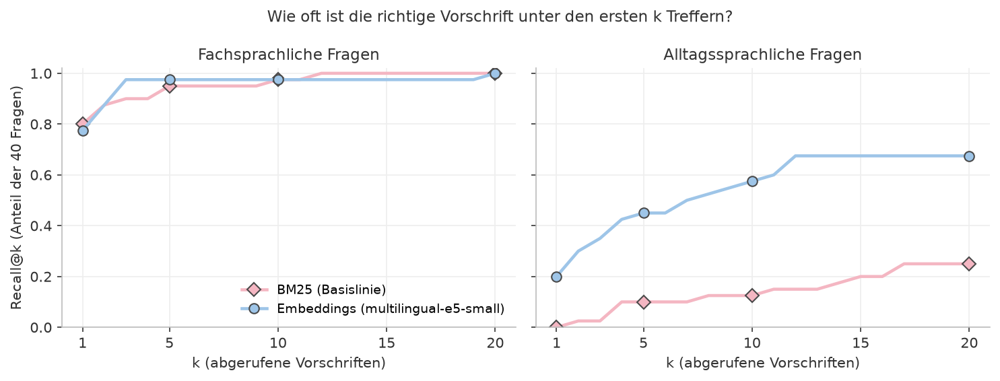

# RAG für das Strahlenschutzrecht

Ein kleiner, nachvollziehbarer Prototyp für Retrieval-Augmented Generation (RAG) auf dem
Strahlenschutzgesetz (StrlSchG) und der Strahlenschutzverordnung (StrlSchV), mit einer
Auswertung, die die Schwächen des Systems sichtbar macht statt sie zu verdecken.

Das Projekt hat drei Teile: Abschnitte des Korpus abrufen, daraus eine Antwort mit Quellenangaben bauen und
messen, wie gut beides funktioniert. Der Schwerpunkt liegt auf dem dritten Teil.

> Keine Rechtsberatung. Antworten des Systems können falsch oder unvollständig sein.

## Kernergebnisse

Abgerufen wird mit mehrsprachigen Embeddings (`intfloat/multilingual-e5-small`) auf Absätzen,
jeweils mit dem Titel der Vorschrift als Präfix. Zum Vergleich dient die wortbasierte Basislinie
BM25 mit Stemming. Gemessen wurde auf 40 selbst erstellten Fragen-Items. Jedes Item gibt es in zwei
Formen: einmal **fachsprachlich**, nah am Gesetzeswortlaut, und einmal **alltagssprachlich**, ohne die
Begriffe der Vorschrift. In Klammern stehen 95-%-Bootstrap-Intervalle über Items.

| Retriever | Frageform | Recall@1 | Recall@5 | MRR |
|---|---|---|---|---|
| BM25 | fachsprachlich | 0,80 [0,68; 0,93] | 0,95 [0,88; 1,00] | 0,86 [0,77; 0,94] |
| BM25 | alltagssprachlich | 0,00 [0,00; 0,00] | 0,10 [0,03; 0,20] | 0,05 [0,02; 0,08] |
| **Embeddings** | fachsprachlich | 0,78 | 0,98 [0,93; 1,00] | 0,86 [0,77; 0,94] |
| **Embeddings** | alltagssprachlich | 0,20 | **0,45** [0,30; 0,60] | **0,32** [0,21; 0,43] |

1. **Embeddings schließen einen Teil der Sprachlücke.** Bei Alltagsfragen steigt Recall@5
   gegenüber BM25 um 0,35 [0,20; 0,53] und die MRR um 0,27 [0,17; 0,38] (gepaarte Differenzen). Bei
   Fachfragen verlieren Embeddings nichts (MRR-Differenz 0,00 [−0,10; +0,09]).
2. **Die Hälfte der Alltagsfragen bleibt ungelöst.** „Wie viel Strahlung darf ich als
   Beschäftigter pro Jahr höchstens abbekommen?“ findet § 78 StrlSchG („Grenzwert der effektiven
   Dosis … beruflich exponierte Personen“) auch mit Embeddings nicht unter den ersten 50 Treffern.
   Unter den ersten 20 Treffern ist die richtige Vorschrift bei Alltagsfragen in 68 % der Fälle,
   bei BM25 in 25 %.
3. **Fachfremde Fragen lassen sich über die Ähnlichkeit erkennen.** Der Score des besten Treffers
   trennt Korpusfragen von 15 fachfremden Fragen mit AUC = 0,98 [0,95; 1,00], bei BM25 mit 0,80
   [0,68; 0,90]. Bei einer Schwelle, die 95 % der Korpusfragen durchlässt, kommt nur eine der 15
   Fremdfragen durch, bei BM25 sind es 11. Die Schwelle ist allerdings auf denselben Fragen gewählt,
   und die Abstände sind klein: Alle Kosinus-Ähnlichkeiten liegen zwischen 0,77 und 0,95.
4. **Der Engpass verschiebt sich zur Antwort.** Bei Alltagsfragen steht das gesuchte Stichwort,
   z. B. „20 Millisievert“, in 48 % der Fälle in den fünf abgerufenen Absätzen, aber nur in 15 % der
   extraktiven Antworten. Die extraktive Antwort wählt Sätze nach Wortüberlappung mit der Frage
   aus und scheitert damit an derselben Lücke wie BM25. Bei Fachfragen liegen die Werte bei 98 %
   und 73 %.

Die nächsten Schritte sind deshalb ein Sprachmodell für die Antwort und eine Umformulierung der
Anfrage durch ein Sprachmodell.



## Aufbau

```
src/strlrag/
  korpus.py      XML von gesetze-im-internet.de -> Vorschriften (Titel, Gliederung, Absätze)
  text.py        Normalisierung, Stoppwörter, CISTEM-Stemmer, Satzzerlegung
  chunking.py    ein Absatz je Chunk, Titel der Vorschrift als Präfix
  retrieval.py   Embeddings (Haupt-Retriever), BM25 (Basislinie)
  anfrage.py     Umformulierung der Anfrage durch ein Sprachmodell (nächster Schritt)
  antwort.py     Prompt mit nummerierten Quellen, Backends (extraktiv, OpenAI-kompatibel, Mock),
                 Enthaltung, Prüfung der Zitate
  evaluation.py  Rang auf Paragraphenebene, Recall@k, MRR, Cluster-Bootstrap, AUC
  daten.py       Pfade und Laden des Standardkorpus
scripts/
  lade_korpus.py     lädt die XML-Dateien nach data/roh/
  pruefe_fragen.py   prüft Soll-Vorschriften und Stichworte gegen den Wortlaut
  experimente.py     wertet die Retriever einer Konfiguration aus
  frage.py           Kommandozeile: Frage stellen, Antwort mit Quellen
configs/
  experimente.yaml      Embeddings gegen BM25 (Ergebnisse oben)
  experimente_llm.yaml  nächster Schritt: Umformulierung der Anfrage per Sprachmodell
data/eval/fragen.yaml  40 Items (fach + alltag), 15 Fremdfragen
tests/               40 Tests auf einem synthetischen Testgesetz
```

## Schnellstart

Auf Linux ohne GPU zuerst die kleinere CPU-Version von PyTorch installieren, sonst lädt pip die
deutlich größere GPU-Version:

```bash
python -m venv .venv && source .venv/bin/activate
pip install torch --index-url https://download.pytorch.org/whl/cpu
pip install -e ".[dev,dense]"
pytest -q                                   # läuft ohne Rohdaten und ohne Modell
python scripts/lade_korpus.py               # StrlSchG + StrlSchV nach data/roh/
python scripts/pruefe_fragen.py             # Fragenset gegen den aktuellen Wortlaut prüfen
python scripts/experimente.py               # lädt beim ersten Lauf das Modell (ca. 470 MB)
python scripts/frage.py "Wie oft ist die Unterweisung zu wiederholen?"
```

Die Embeddings des Korpus werden in `data/cache/` zwischengespeichert. Weitere Läufe kodieren
nur noch die Fragen. Ein anderes Modell lässt sich über den Namen wählen, z. B.
`--retriever dense:intfloat/multilingual-e5-base`.

Ausgabe mit der Basislinie (`--retriever bm25`) auf eine Fachfrage:

```
Danach ist die Unterweisung mindestens einmal im Jahr zu wiederholen. [1] Die Unterweisung hat mündlich zu erfolgen. [2]

[1] StrlSchV § 63 Abs. 1 (Unterweisung)
[2] StrlSchV § 63 Abs. 3 (Unterweisung)
...
```

Und auf eine Alltagsfrage, mit einer selbstsicheren, aber falschen Antwort:

```
$ python scripts/frage.py --retriever bm25 "Wie viel Strahlung darf ich als Beschäftigter pro Jahr höchstens abbekommen?"
Die Genehmigung wird auf längstens fünf Jahre befristet. [2] ...

[1] StrlSchG § 25 Abs. 1 (Genehmigungsbedürftige Beschäftigung in fremden Anlagen oder Einrichtungen)
...
```

Die Zitate sind formal korrekt, die Quellen passen aber nicht zur Frage. Genau diesen Fall
soll die Auswertung erfassen.

Nächster Schritt, die Umformulierung mit einem lokalen Sprachmodell, z. B. über [Ollama](https://ollama.com):

```bash
export LLM_BASE_URL=http://localhost:11434/v1 LLM_MODEL=llama3.1:8b
python scripts/experimente.py --config configs/experimente_llm.yaml \
       --aus ergebnisse_llm --abbildungen docs/abbildungen_llm
```

## Methode

**Korpus.** XML-Fassungen von [gesetze-im-internet.de](https://www.gesetze-im-internet.de)
(StrlSchG Stand 02.11.2026, StrlSchV Stand 05.08.2025): 459 Vorschriften einschließlich
28 Anlagen, rund 118.000 Wörter. Inhaltsübersichten, Fußnoten und weggefallene Paragraphen
werden übersprungen. Die Texte sind amtliche Werke (§ 5 UrhG). Sie liegen trotzdem nicht im
Repository, damit stets die aktuelle Fassung geladen wird.

**Zerlegung.** Ein Absatz je Chunk, insgesamt 1.397. Absätze sind die Einheit, auf die
Rechtstexte selbst verweisen („§ 78 Abs. 4“), und erlauben präzise Quellenangaben. Der Titel der
Vorschrift wird als Präfix mitindexiert, weil viele Absätze für sich nicht sagen, worum es geht.

**Retriever.**
- **Embeddings:** `intfloat/multilingual-e5-small` über sentence-transformers, mit den von E5
  erwarteten Präfixen „query: “ und „passage: “, normiert und per Kosinus-Ähnlichkeit verglichen.
- **BM25** (k1 = 1,2, b = 0,75) als Basislinie: Tokens mit gefalteten Umlauten, entfernten
  Stoppwörtern und CISTEM-Stemming (Weissweiler & Fraser 2017).

**Bewertung.** Ein Treffer zählt auf Paragraphenebene: Liegt ein abgerufener Absatz in einer
Soll-Vorschrift, ist die Frage beantwortet. Mehrere Absätze derselben Vorschrift zählen für den
Rang nur einmal. Unsicherheiten stammen aus einem Cluster-Bootstrap über Items mit 2.000
Ziehungen, bei dem beide Formulierungen eines Items gemeinsam gezogen werden. Vergleiche mit der
Basislinie laufen gepaart auf denselben Fragen.

**Antwort.** Die extraktive Basislinie wählt die zwei Sätze aus den fünf besten Absätzen, die
der Frage per TF-IDF am ähnlichsten sind, und hängt die Quellennummer an. Für ein Sprachmodell
wird ein Prompt mit nummerierten Quellen und einer festen Enthaltungsformel gebaut.
`Antwort.ungueltige_zitate` meldet Quellennummern, die es im Kontext nicht gibt.

**Fragenset.** Zu jedem Item gibt es Soll-Vorschriften und ein Stichwort aus dem Wortlaut,
z. B. „300 Becquerel je Kubikmeter“. `scripts/pruefe_fragen.py` stellt sicher, dass jedes Stichwort
tatsächlich in einer Soll-Vorschrift steht. Der zeitgesteuerte CI-Job wiederholt diese Prüfung
wöchentlich gegen die aktuelle Gesetzesfassung.


## Grenzen und nicht Getestetes

- **Das Fragenset ist klein und verzerrt.** 40 Items von einer Person. Die Fachfragen entstanden
  nach Lektüre der Vorschrift und sind dadurch für wortbasierte Verfahren eher zu leicht. Die
  Alltagsfragen vermeiden die Begriffe der Vorschrift bewusst und sind dadurch eher zu schwer.
  Echte Nutzerfragen dürften dazwischen liegen. Die Intervalle sind entsprechend breit.
- **Bewertet wird nur, ob die richtige Vorschrift gefunden wird.** Ob eine Antwort juristisch
  vollständig ist, misst die Auswertung nicht. Verweise zwischen Vorschriften, etwa „nach § 121
  Absatz 1“, werden nicht aufgelöst.
- **Die Enthaltungsschwelle ist nicht unabhängig festgelegt.** Sie wurde auf denselben Fragen
  bestimmt, an denen sie gemessen wird. Für den Einsatz müsste sie auf einem eigenen Fragenset
  festgelegt werden.
- **Lange Absätze werden abgeschnitten.** E5 verarbeitet höchstens 512 Tokens. Etwa 36 der 1.397
  Absätze haben mehr als 300 Wörter und dürften gekürzt in die Embeddings eingehen, vor allem
  Tabellen in den Anlagen.
- **Getestet:** Embeddings wurden lokal unter Python 3.12 ausgeführt, in den Tests nur mit einem
  Ersatzmodell. Die Entwicklungsumgebung lief unter Python 3.13.
- **Nicht ausgeführt:**
  - `OpenAIKompatibelBackend` gegen ein echtes Modell
  - `UmformulierRetriever` mit echtem Modell (nur mit Mock getestet)
  - `scripts/lade_korpus.py` (die Rohdaten wurden manuell heruntergeladen)
  - die CI

## Nächste Schritte

1. Ein Sprachmodell für die Antwort einbinden und messen: Abdeckung der Stichworte und Zitattreue,
   besonders bei Alltagsfragen.
2. Die Umformulierung der Anfrage (`configs/experimente_llm.yaml`) gegen Embeddings allein messen.
3. Das Fragenset von weiteren Personen formulieren lassen, Fragen ohne Lektüre der Vorschriften
   ergänzen und einen Teil für die Wahl der Enthaltungsschwelle zurückhalten.
